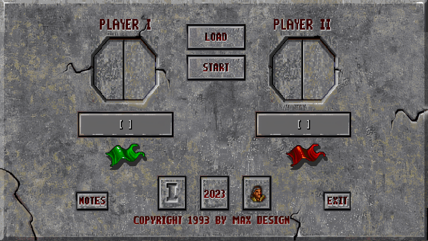
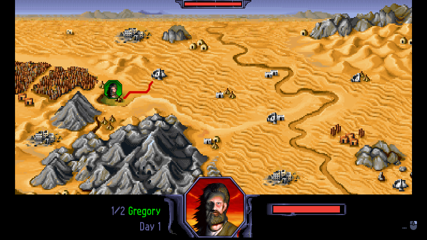
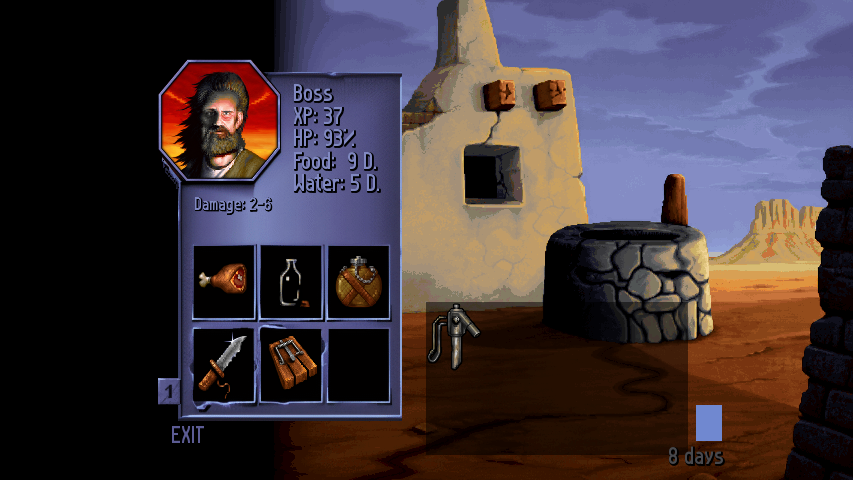

# Burntime Remastered 1.3 for AROS

A port of [Burntime Remastered](https://github.com/jakobharder/burntime) by
Jakob Harder to AROS: a fork of its rules and file formats, rewritten in
Rust. It is a separate project, not affiliated with the remaster. Burntime
is Max Design's 1993 strategy game of survival after the bomb. This port
follows the remaster's version 1.3: its rules (Classic and Extended, the
Modern, Amiga and None opponents, New Village) and its look (the original
graphics or the remaster's, four player colours).

The program downloads do not include game data. You need your own copy of Burntime and
the remaster's files, from which you make one data file, `burntime.pack`.

## Screenshots

Screenshots from the desktop build of this port, using the remastered graphics.







Game artwork belongs to its respective owners; see [NOTICE](NOTICE) for credits.

## Downloads

Releases are on this repository's Releases page:

| Archive | System |
|---|---|
| `Burntime-1.3-aros1-aros-x86_64-abiv11-pc.zip`, `.apkg.zip` | AROS One and other x86_64 ABIv11 systems |
| `Burntime-1.3-aros1-aros-x86_64-abiv1-pc.zip`, `.apkg.zip` | AROS mainline (ABIv1) on x86_64 PCs |
| `Burntime-1.3-aros1-aros-aarch64-abiv1-raspi.zip` | AROS on the Raspberry Pi |
| `Burntime-1.3-aros1-source.zip` | the source of the release |

The `.apkg.zip` files install with apkg or PkgManager
([arospkg](https://github.com/tomaszstaniak/arospkg), 0.7.4 or later recommended). The `ReadMe` in each
archive explains installation, the data file and the known limitations.

## Building

The source needs the `aros` crate of
[rust-aros](https://github.com/tomaszstaniak/rust-aros) at `../rust-aros/aros`.
The release's source archive contains it; unpack the archive and work in its
`aros-burntime` directory. Before the first AROS build, run `setup.sh` in
`rust-aros` once (with `AROS_GCC` and `AROS_SDK` set to the target's
compiler and SDK if it does not find them): it writes the `aros-env.toml`
the AROS builds read.

On the host you need Rust and, for the game and the viewer, SDL2 with
`sdl2-config` on `PATH`. The packer needs neither.

### The data file

```sh
cargo build --release -p packer
target/release/packer --from DIR --out burntime.pack --newgfx full
```

`DIR` holds your files laid out as
[`burngfx/testdata/README.md`](burngfx/testdata/README.md) describes: the
remaster's 1.2 files, and in `DIR/v1.3/` the files version 1.3 changed.
`--newgfx full` adds the remaster's graphics (a pack of about 115 MB;
without it, about 21 MB and the original graphics only).

### The AROS programs

```sh
scripts/build.sh aros-x86_64-abiv11-pc        # or aros-x86_64-abiv1-pc, aros-aarch64-abiv1-raspi
scripts/package.sh TARGET 1.3 1 OUTDIR        # the archives
```

`targets/TARGET.env` names the cross compiler and SDK; each setting can be
overridden from the environment. The ABIv1 targets also need the static SDL2,
SDL2_mixer and libiconv that `scripts/deps.py TARGET` builds. Never strip the
AROS executable: the loader needs its relocations.

### On the host

```sh
cargo build --workspace
cargo run --release -p aros-game     # reads Data/burntime.pack beside the program
```

Many tests read the game's files from `burngfx/testdata` and fail without
them; only the tests built on their own small tables pass on a fresh checkout.
Put your files there as `burngfx/testdata/README.md` describes, then run
`cargo test --workspace`. `scripts/pack.sh` writes
`burngfx/testdata/burntime.pack` from them.

The 1993 file formats are described in [docs/formats.md](docs/formats.md).

## Licence

This program's code is MIT, Tomasz Staniak (`LICENSE`). The parts
translated from the remaster are under its MIT licence, Jakob Harder
(`LICENSE.upstream-burntime`). The AROS programs link libraries that keep
their own licences: SDL2 and SDL2_mixer (zlib), GNU libiconv (LGPL), and
others listed in `LICENSE.third-party` and `LICENSE.libiconv`; the build
patches SDL2 (`third_party/sdl2`). `NOTICE` lists the origin, the libraries and the
credits. These licences cover code only: Burntime's data belongs to Max
Design and is not distributed here.
